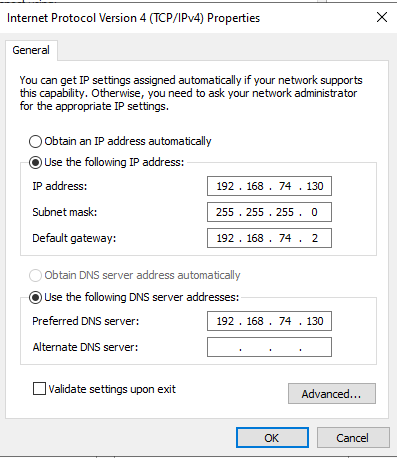

# 🌐 02 | Network Configuration and Active Directory

Assign a static IP address to the server, install Active Directory Domain Services (AD DS), and promote the server to the first domain controller of a new forest.

## 🎓 What you will learn

- Why a domain controller needs a static IP address
- How to install the Active Directory Domain Services role
- How to promote a server to a domain controller and create the `lab.local` forest

## 📋 Prerequisites

- Module 01 finished
- The server VM runs and you sign in as Administrator

## 🎯 Objective

Create the `lab.local` domain with one domain controller.

## 📖 Background

Active Directory is the directory database that stores and manages network resources such as users, groups, computers, and policies. A domain controller (DC) hosts that database and answers authentication requests. A static IP is required because clients locate the DC through DNS, and the address must not change after a restart.

## 🔧 Part 1: Set a static IP address

1. Open **Network and Internet settings** from the taskbar and select **Ethernet**.
2. Select **Change adapter options** and open **Ethernet0**.
3. Select **Details** and write down the current IPv4 address, subnet mask, default gateway, and DNS server.
4. Close the window and open **Properties**.
5. Double-click **Internet Protocol Version 4 (TCP/IPv4)**.
6. Select **Use the following IP address** and enter the values you recorded.
7. Set the preferred DNS server to the server's own IP address. The DC will host DNS.
8. Select OK, OK, Close.

Tip: reuse the address the server already holds. It is valid for your network and does not collide with other devices.

## 🔧 Part 2: Install Active Directory Domain Services

1. Open **Server Manager**.
2. Select **Add roles and features** and select Next until you reach **Server Roles**.
3. Check **Active Directory Domain Services** and select **Add Features**.
4. Select Next through the remaining pages, then select **Install**.
5. Wait for the installation to finish.

## 🔧 Part 3: Promote the server to a domain controller

1. In Server Manager, select the notification flag and choose **Promote this server to a domain controller**.
2. Select **Add a new forest** and enter the root domain name, for example `lab.local`.
3. Set a **Directory Services Restore Mode (DSRM)** password. Store it safely.
4. Accept the defaults on the remaining pages and select **Install**.
5. The server restarts automatically.

## ✅ Verification

1. Open **Start > Windows Administrative Tools > Active Directory Users and Computers**.
2. Expand the domain. You see these default containers:
   - Builtin
   - Computers
   - Domain Controllers
   - ForeignSecurityPrincipals
   - Managed Service Accounts
   - Users

## 📝 Notes

- Use a `.local` suffix for isolated labs only. Production environments use a registered domain or subdomain you own.
- Keep the same domain name across all modules. The remaining modules use `lab.local`.

## ➡️ Next

[03 Users, OUs, and groups](../03-users-ous-groups/README.md)
