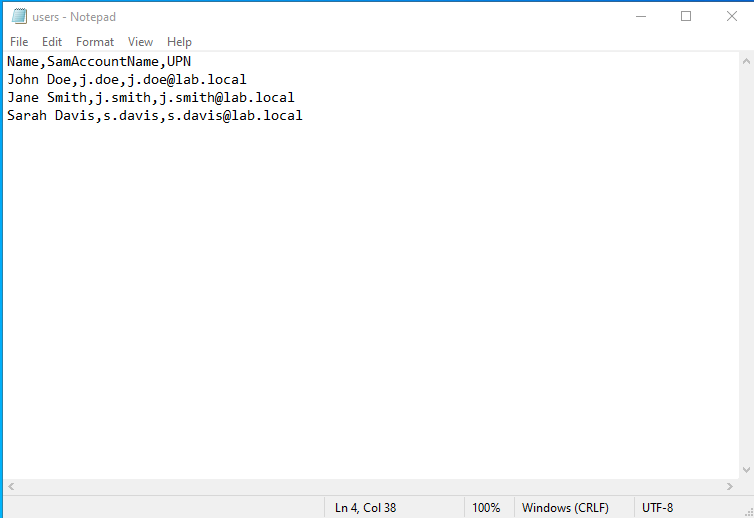
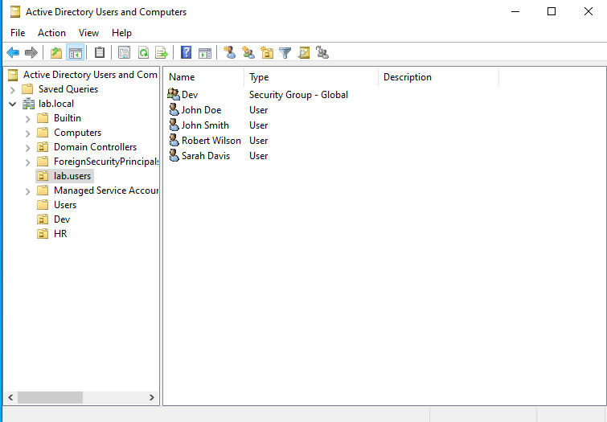

# 👥 03 | Users, Organizational Units, and Groups

Create an Organizational Unit (OU), add user accounts manually and in bulk with PowerShell, and build a security group for role-based access.

## 🎓 What you will learn

- The difference between a user, a group, and an OU
- How to create users in the GUI and in bulk with PowerShell
- How to build a security group for role-based access

## 📋 Prerequisites

- Module 02 finished
- The `lab.local` domain controller runs

## ⚡ Automation

The steps in parts 1 to 4 are scripted in [`Scripts/Create-LabUsers.ps1`](../Scripts/Create-LabUsers.ps1).

## 🎯 Objective

Populate `lab.local` with four users in the `lab.users` OU and place two of them in a `Dev` security group.

## 📖 Key terms

| Term | Analogy | Purpose |
|---|---|---|
| User | Employee badge | An identity with a name and password that proves who is signing in |
| Group | Access keycard | A collection of users. Assign a permission to the group once instead of to each person |
| OU (Organizational Unit) | Office room | A container that organizes users, groups, and computers. Group Policy links to OUs. An OU does not grant file access by itself |

## 🧩 Target state

| Display name | Logon name | Created by | Group |
|---|---|---|---|
| John Smith | `j.smith` | GUI | none |
| John Doe | `j.doe` | PowerShell | Dev |
| Sarah Davis | `s.davis` | PowerShell | none |
| Robert Wilson | `r.wilson` | PowerShell | Dev |

## 🔧 Part 1: Create the OU

1. Open **Active Directory Users and Computers**.
2. Right-click `lab.local` and select **New > Organizational Unit**.
3. Name it `lab.users` and select OK.

## 🔧 Part 2: Create a user in the GUI

1. Right-click `lab.users` and select **New > User**.
2. Enter first name `John`, last name `Smith`, and logon name `j.smith`. Select Next.
3. Enter a strong password and retype it.
4. Check **User must change password at next logon**. This lets each person choose a password they remember.
5. Select Next, then Finish.

## 🔧 Part 3: Create users in bulk with PowerShell

A CSV file plus one command creates many accounts and lets you repeat the process later by adding rows.

1. On the server desktop, create a text file with this content. Put each record on its own line and use no extra spaces:

```csv
Name,SamAccountName,UPN
John Doe,j.doe,j.doe@lab.local
Sarah Davis,s.davis,s.davis@lab.local
Robert Wilson,r.wilson,r.wilson@lab.local
```

2. Save it as `users.csv` (file type: All Files) on the Administrator desktop.



3. Find the distinguished name of your OU:

```powershell
Get-ADObject -Filter "Name -eq 'lab.users'" | Select-Object DistinguishedName
```

The expected result is `OU=lab.users,DC=lab,DC=local`. Use your own value in the next command if it differs.

4. Open **PowerShell as Administrator** and run:

```powershell
$tempPassword = Read-Host -AsSecureString "Enter a temporary password"

Import-Csv "C:\Users\Administrator\Desktop\users.csv" | ForEach-Object {
    New-ADUser -Name $_.Name `
        -SamAccountName $_.SamAccountName `
        -UserPrincipalName $_.UPN `
        -Path "OU=lab.users,DC=lab,DC=local" `
        -AccountPassword $tempPassword `
        -ChangePasswordAtLogon $true `
        -Enabled $true
}
```

5. In Active Directory Users and Computers, right-click `lab.users` and select **Refresh**. The new users appear.

The prompt keeps the password out of your script and your screenshots. Each account requires a password change at first sign-in.

## 🔧 Part 4: Create the Dev security group

1. Right-click `lab.users` and select **New > Group**.
2. Name it `Dev`. Set **Group scope** to `Global` and **Group type** to `Security`. Select OK.
3. Double-click `Dev` and open the **Members** tab.
4. Select **Add**, type `john`, select **Check Names**, choose **John Doe**, and select OK.
5. Repeat for **Robert Wilson**.
6. Select Apply, then OK.



## ✅ Verification

- `lab.users` lists four user accounts and the `Dev` group.
- The `Dev` group Members tab shows John Doe and Robert Wilson.

## ➡️ Next

[04 Folder permissions](../04-folder-permissions/README.md)
