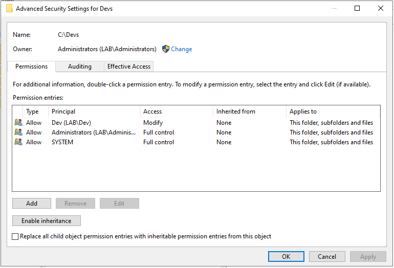
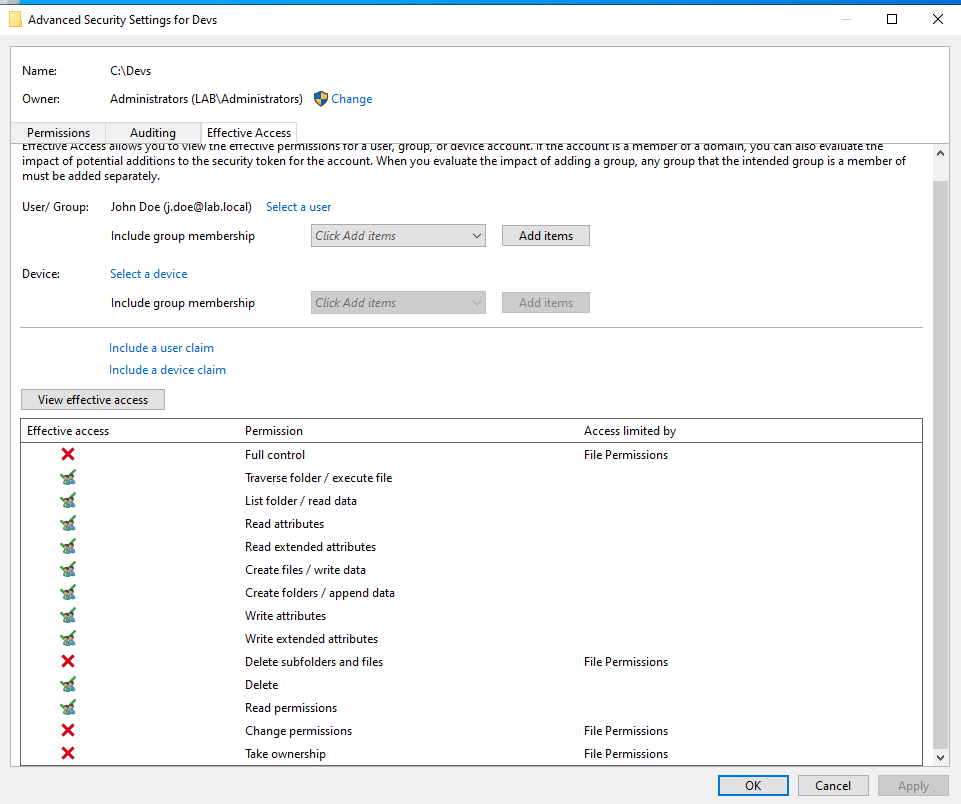
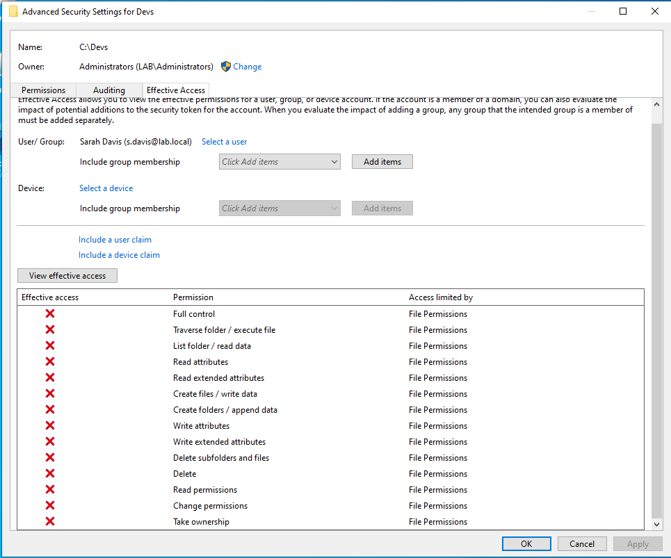

# 📁 04 | Folder Permissions (NTFS and SMB Share)

Restrict a folder to one security group with NTFS permissions, verify the result with Effective Access, and publish the folder as an SMB share for client testing.

## 🎓 What you will learn

- How NTFS permissions control access to a folder
- How to disable inheritance and set least-privilege entries
- How to check access with the Effective Access tool
- How to publish the folder as an SMB share

## 📋 Prerequisites

- Module 03 finished
- Users `j.doe` and `s.davis` exist and `j.doe` is in the `Dev` group

## 🎯 Objective

Give the `Dev` group Modify access to a folder. Give Administrators and SYSTEM Full Control. Deny everyone else.

## 📖 Background

Folder permissions define who accesses a folder and what each person does inside it. The levels are Read, Write, Modify, and Full Control. They matter for three reasons:

- Least privilege: users reach only the data their job requires, so HR, finance, and system files stay hidden from other staff.
- Damage control: limiting write and modify rights prevents accidental deletion and limits how far ransomware spreads across network shares.
- Accountability: clear permissions make it possible to audit who creates, changes, or deletes files.

## 🔧 Part 1: Create the folder

1. On the `C:` drive, create a folder named `Dev files`.
2. Inside it, create a text file named `d01`.

## 🔧 Part 2: Set explicit NTFS permissions

1. Right-click the folder and select **Properties > Security > Advanced**.
2. Select **Disable inheritance**.
3. In the prompt, select **Remove all inherited permissions from this object**.
4. Select **Add**, then **Select a principal**. Type `Dev`, select **Check Names**, and select OK.
5. Set **Type** to `Allow` and **Basic permissions** to `Modify`. Select OK.

Removing inheritance also removes access for administrators and the operating system. Restore both:

6. Select **Add > Select a principal**, type `Administrators`, check the name, and select OK. Enable **Full control** and select OK.
7. Repeat for `SYSTEM` with **Full control**.
8. Select Apply, OK, OK.



## 🔧 Part 3: Verify with Effective Access

1. Right-click the folder and select **Properties > Security > Advanced**.
2. Open the **Effective Access** tab and select **Select a user**.
3. Type `john doe`, check the name, and select OK. Select **View effective access**.
4. John Doe is in the `Dev` group, so Modify rights appear checked.



5. Repeat with `Sarah`. She is not in the `Dev` group, so no permission is checked.



## 🔧 Part 4: Share the folder over SMB

1. Close the Advanced Security window.
2. Right-click the folder and select **Properties > Sharing > Share**.
3. Set the share name to `Devs`, select Share, then Done.
4. Write down the network path:

```text
\\<SERVER-NAME>\Devs
```

In the original lab this path was `\\WIN-7JARJ7Q5IEJ\Devs`. You use it in the client test in module 06.

## 🔗 How share and NTFS permissions combine

SMB access passes through both layers. The more restrictive result wins. A user who has Modify on NTFS but only Read on the share receives Read access over the network.

## ✅ Verification

| User | Group | Expected result |
|---|---|---|
| John Doe | Dev | Modify access |
| Sarah Davis | none | No access |

## ➡️ Next

[05 Group Policy and password policy](../05-group-policy-and-password-policy/README.md)
