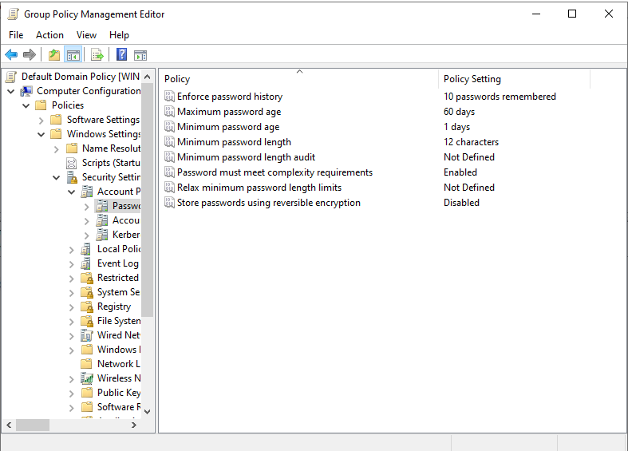
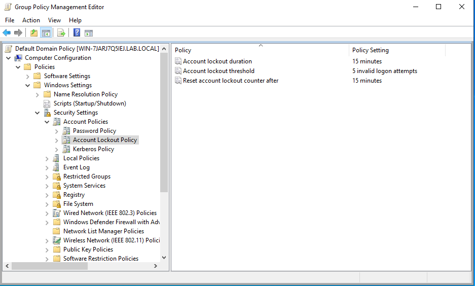
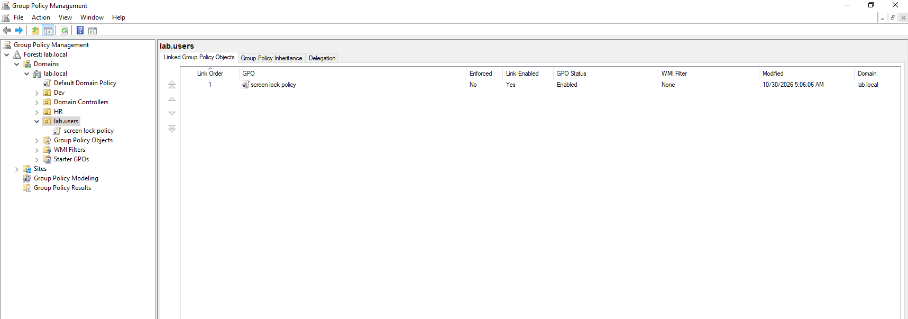
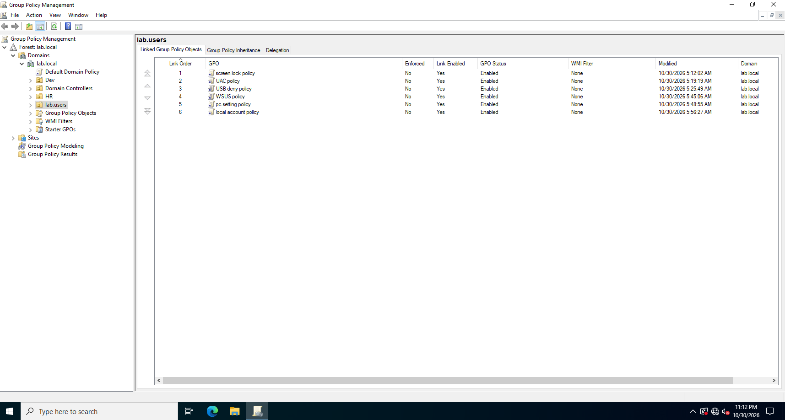
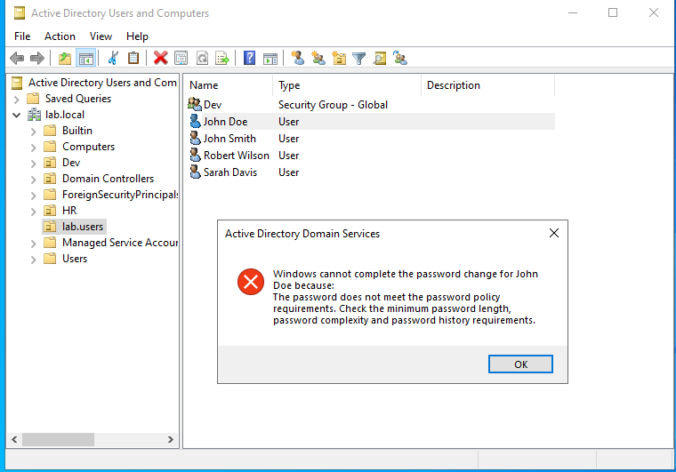
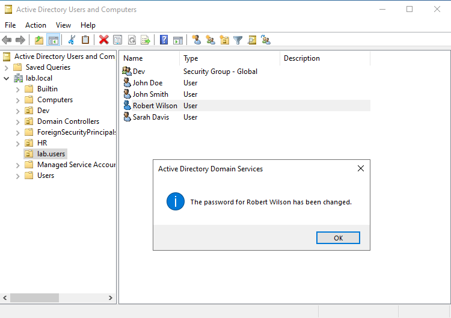

# 05 | Group Policy: Password, Lockout, and Workstation Controls

Configure domain-wide password and account lockout rules, then create linked Group Policy Objects (GPOs) that harden user sessions and workstations.

## Objective

Apply eight security controls and confirm that the password policy rejects a weak password.

## Policies in this module

| Control | What it does |
|---|---|
| Password policy | Sets minimum length, complexity, history, and age rules |
| Account lockout | Locks an account after repeated failed sign-ins |
| Screen saver timeout | Locks an idle screen after a set time |
| User Account Control (UAC) | Prompts before system-level changes |
| Removable storage deny | Blocks USB drives and external disks |
| Software installation block | Stops standard users from installing programs |
| Control Panel block | Hides system settings from standard users |
| Built-in account disable | Turns off the default Administrator and Guest accounts |

## Why these controls matter

- They stop brute-force attacks. A lockout cuts off an attacker after a few guesses.
- They limit the damage of a leaked password. A long password is harder to crack.
- They enforce good habits. Users must pick strong passphrases instead of `Password123`.
- They reduce data theft, malware, and accidental misconfiguration.

## Part 1: Password policy

1. Open **Group Policy Management** from the search bar or Server Manager (Tools menu).
2. Expand **Forest > Domains > lab.local**.
3. Right-click **Default Domain Policy** and select **Edit**.
4. Go to **Computer Configuration > Policies > Windows Settings > Security Settings > Account Policies > Password Policy**.
5. Double-click each setting and apply these values:

| Setting | Value |
|---|---|
| Enforce password history | 10 passwords remembered |
| Maximum password age | 60 days |
| Minimum password age | 1 day |
| Minimum password length | 12 characters |
| Password must meet complexity requirements | Enabled |



## Part 2: Account lockout policy

In the left pane, select **Account Lockout Policy** (below Password Policy) and apply:

| Setting | Value |
|---|---|
| Account lockout threshold | 5 invalid logon attempts |
| Account lockout duration | 15 minutes |
| Reset account lockout counter after | 15 minutes |



## Part 3: Force the policy update

Group Policy refreshes up to 90 minutes after a change. Apply it now. Open **Command Prompt as Administrator** and run:

```cmd
gpupdate /force
```

Wait for both messages:

```text
Computer Policy update has completed successfully.
User Policy update has completed successfully.
```

## Part 4: Create linked GPOs

Link each of the following GPOs to the `lab.users` OU. For every one:

1. Open **Group Policy Management** (`gpmc.msc`) and expand **lab.local**.
2. Right-click `lab.users` and select **Create a GPO in this domain, and Link it here**.
3. Enter the GPO name, right-click it, and select **Edit**.
4. Go to the path in the table, set the value, then select Apply and OK.

| GPO name | Policy path | Setting |
|---|---|---|
| `screen lock policy` | User Configuration > Policies > Administrative Templates > Control Panel > Personalization > Screen saver timeout | Enabled, 900 seconds (15 minutes) |
| `UAC policy` | Computer Configuration > Policies > Windows Settings > Security Settings > Local Policies > Security Options > User Account Control: Admin Approval Mode for the built-in Administrator account | Enabled |
| `usb deny policy` | Computer Configuration > Policies > Administrative Templates > System > Removable Storage Access > All Removable Storage classes: Deny all access | Enabled |
| `software policy` | Computer Configuration > Policies > Administrative Templates > Windows Components > Windows Installer > Turn off Windows Installer | Enabled, set to Always |
| `pc setting policy` | User Configuration > Policies > Administrative Templates > Control Panel > Prohibit access to Control Panel and PC settings | Enabled |
| `local policy` | Computer Configuration > Policies > Windows Settings > Security Settings > Local Policies > Security Options > Accounts: Administrator account status and Accounts: Guest account status | Define this policy setting, Disabled |

If the screen saver timeout does not accept a value, enable the policy first. The default is 900 seconds.





## Part 5: Test the password policy

1. Open **Active Directory Users and Computers** and go to `lab.users`.
2. Right-click **John Doe** and select **Reset Password**.
3. Enter `P@ssw0rd123`. This password has 11 characters, so it fails the 12-character minimum and the server shows an error.



4. Right-click **Robert Wilson** and select **Reset Password**.
5. Enter a strong password of 12 or more characters with mixed case, numbers, and symbols. The reset succeeds.



## Verification

- `gpupdate /force` finishes without errors.
- The weak password is rejected and the strong password is accepted.
- Run `gpresult /r` or open **Group Policy Results** to confirm the final applied values.

## Scope warnings

- Computer Configuration settings (UAC, USB, installer, local accounts) apply only to computer accounts inside the OU where the GPO is linked. A new domain-joined computer lands in the default `Computers` container, which this link does not cover. Move the client computer account into a dedicated OU, or link the GPO at a level that includes it.
- Disabling the built-in Administrator account is risky. Keep a second administrative account and a recovery path before you apply it.
- Treat these values as lab settings, not a production baseline. Test lockout, USB, and installer restrictions on a pilot group first.

## Next

[06 Client VM and testing](../06-client-vm-and-testing/README.md)
