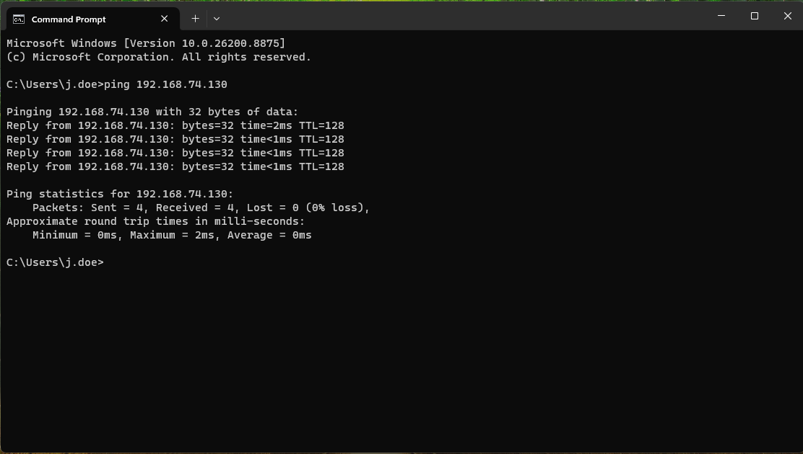
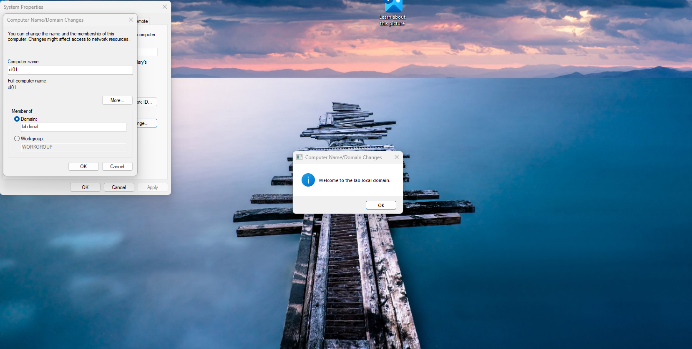
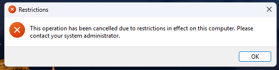
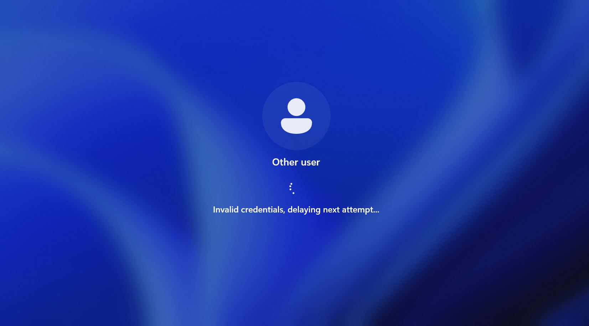
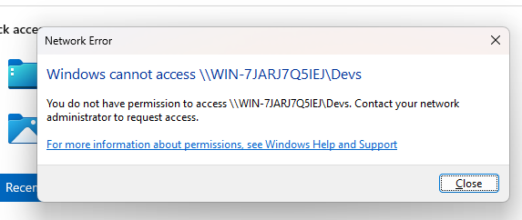

# 06 | Windows 11 Client VM and End-to-End Testing

Build a Windows 11 Pro client, join it to `lab.local`, and test password, lockout, Group Policy, and file share permissions from a user's point of view.

## Objective

Prove that the policies and permissions from modules 03 to 05 work on a real domain client.

## Why Windows 11 Pro

Enterprise edition is common in medium and large companies. Pro is enough for this lab and joins a domain without extra licensing steps.

## Requirements

| Item | Value |
|---|---|
| ISO | Windows 11 Pro from Microsoft |
| Disk | 50 GB |
| Computer name | `CL01` |
| Network | NAT, same virtual network as the server |
| Server | Running and reachable |

## Part 1: Create the VM

1. In VMware Workstation, select **Create a New Virtual Machine** and choose **Typical**.
2. Select **I will install the operating system later**.
3. Pick the closest supported guest OS entry (Windows 10 x64 in the original lab).
4. Name the VM `Windows 11 pro`.
5. If VMware asks for an encryption password, set one you remember.
6. Set the disk size to 50 GB and finish the wizard.
7. Select **Edit virtual machine settings > CD/DVD (SATA) > Use ISO image file** and browse to the Windows 11 Pro ISO.

## Part 2: Install Windows 11 Pro

1. Power on the VM and press any key at the boot prompt.
2. Choose language and select **Install now**.
3. Accept the terms and choose **Custom install**.
4. Select the drive and select Next. Wait for the restarts.
5. Choose your country and the US keyboard layout. Skip the second layout.
6. Name the device `CL01`.
7. Select **Set up for work or school**.
8. Skip the Microsoft sign-in: choose **Sign-in options > Domain join instead**.
9. Skip the email prompt, then enter a local user name, password, and security answers.
10. Postpone updates for later.

## Part 3: Connect the client to the server

1. In VMware, right-click the server VM and open **Settings > Network Adapter**. Confirm both VMs use **NAT**.
2. On the client, press **Win + R**, type `ncpa.cpl`, and press Enter.
3. Right-click **Ethernet > Properties > Internet Protocol Version 4 (TCP/IPv4)**.
4. Select **Use the following DNS server addresses** and enter the server's IPv4 address as the preferred DNS server.
5. Select OK, OK.
6. With the server running, open Command Prompt on the client and test connectivity:

```cmd
ping 192.168.74.130
```

Replace the address with your server IP.



## Part 4: Join the domain

1. Press **Win + R**, type `sysdm.cpl`, and press Enter.
2. On the **Computer Name** tab, select **Change**.
3. Under **Member of**, select **Domain** and enter `lab.local`.
4. Select OK. Enter the credentials for `j.doe`.
5. If the password fails, reset it in Active Directory Users and Computers on the server. The password policy from module 05 may reject older passwords.
6. A welcome message appears. Select OK and restart the VM.



7. After the restart, select **Other user** and sign in as `j.doe` with the new password.


## Part 5: Apply Group Policy

1. On the client, open Command Prompt and run:

```cmd
gpupdate /force
```

2. If you see a time error, fix time sync from the server:
   - Create a GPO on `lab.local` named `time policy`.
   - Edit it: **Computer Configuration > Policies > Administrative Templates > System > Windows Time Service > Time Providers > Configure Windows NTP Client**.
   - Set it to **Enabled** and choose `NT5DS` in the Type drop-down. Select Apply and OK.
   - Return to the client and run `gpupdate /force` again.

3. Open **Control Panel**. The policy blocks it with an error message.



## Part 6: Test the file share as John Doe

1. Open File Explorer and enter the share path in the address bar:

```text
\\<SERVER-NAME>\Devs
```

2. The folder opens. John Doe is in the `Dev` group and has Modify access, so he reads and edits files.

## Part 7: Test lockout and access denial as Sarah Davis

1. Lock the client: **Start > Power icon > Lock**.
2. Select **Other user**, enter `s.davis`, and type a wrong password five times. The account locks.



3. On the server, open **Active Directory Users and Computers > lab.users**.
4. Right-click **Sarah Davis** and select **Reset Password**. Enter a new password and check both boxes: **User must change password at next logon** and **Unlock the user's account**.
5. On the client, restart the VM and sign in as `s.davis` with the new password.
6. Windows asks for a new password. Enter a strong one and retype it. The first sign-in takes a minute because the profile is new.
7. Open **Control Panel**. It is blocked, as before.
8. Open the share path again:

```text
\\<SERVER-NAME>\Devs
```

Sarah is not in the `Dev` group, so Windows shows a permission error.



## Test summary

| Test | User | Expected result |
|---|---|---|
| Domain join | j.doe | Join succeeds, welcome message shown |
| Control Panel | j.doe, s.davis | Blocked by policy |
| Devs share | j.doe | Opens with Modify access |
| Failed sign-ins | s.davis | Account locks after 5 attempts |
| Devs share | s.davis | Access denied |

## Result

The lab covers the full path from server installation to user-level validation. You built a domain, organized identities, applied security controls, and confirmed that each control works on a domain client.

## Back to the index

[Lab overview](../README.md)
