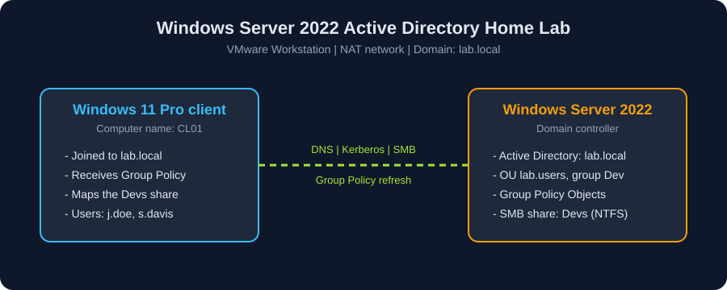

<div align="center">

# 🏢 Windows Server 2022 Active Directory Home Lab

A virtualized Windows domain built from scratch: server install, Active Directory, users and groups, Group Policy, file permissions, and end-user testing from a Windows 11 client.




</div>

## 📌 Overview

You build a small corporate network inside VMware. One Windows Server 2022 machine is the domain controller. One Windows 11 Pro machine is an employee workstation. You configure security controls on the server, then prove each control works from the client.

Every module follows the same format: what you will learn, prerequisites, steps with screenshots, verification, and troubleshooting.

## 🧠 Skills demonstrated

- Virtual machine provisioning and Windows Server installation
- Static IPv4 configuration, DNS, and Active Directory Domain Services
- Domain controller promotion and forest creation
- Organizational Units, users, and security groups
- Bulk user creation with PowerShell and CSV
- Group Policy: password, lockout, UAC, USB, installer, and Control Panel controls
- NTFS permissions, SMB shares, and Effective Access checks
- Domain join and policy validation from a client
- PowerShell automation and health checks

## 🗺️ Learning path

| # | Module | What you build | Time |
|---|---|---|---|
| 01 | [🖥️ Windows Server installation](01-windows-server-installation/README.md) | A Windows Server 2022 VM with a signed-in Administrator | 30 min |
| 02 | [🌐 Network and Active Directory](02-network-and-active-directory/README.md) | Static IP, AD DS role, and the `lab.local` domain | 30 min |
| 03 | [👥 Users, OUs, and groups](03-users-ous-groups/README.md) | Four users in `lab.users` and the `Dev` group | 30 min |
| 04 | [📁 Folder permissions](04-folder-permissions/README.md) | A `Devs` share limited to the `Dev` group | 30 min |
| 05 | [🛡️ Group Policy and password policy](05-group-policy-and-password-policy/README.md) | Password, lockout, and workstation controls | 60 min |
| 06 | [💻 Client VM and testing](06-client-vm-and-testing/README.md) | A domain-joined client with verified policies and access | 60 min |

Follow the modules in order. Each one builds on the previous result. Times are estimates for a first run.

## ⚡ Scripts

The [`Scripts`](Scripts/README.md) folder holds PowerShell versions of the manual steps.

| Script | Purpose |
|---|---|
| [`Create-LabUsers.ps1`](Scripts/Create-LabUsers.ps1) | Creates the OU, users from CSV, and the `Dev` group |
| [`Set-PasswordPolicy.ps1`](Scripts/Set-PasswordPolicy.ps1) | Applies the password and lockout policy |
| [`Test-LabHealth.ps1`](Scripts/Test-LabHealth.ps1) | Prints PASS or FAIL for the main lab objects and settings |

## 🧱 Lab specification

| Component | Configuration |
|---|---|
| Server VM | Windows Server 2022 Datacenter Evaluation (Desktop Experience), 2 vCPU, 2 GB RAM, 60 GB disk |
| Client VM | Windows 11 Pro, 50 GB disk, computer name `CL01` |
| Hypervisor | VMware Workstation Pro |
| Network | NAT, client DNS points to the domain controller |
| Domain | `lab.local` |
| Evaluation period | 180 days for Windows Server |
| Host PC | 8 GB RAM and 100 GB free disk space or more |

## 🔐 Identity model

| User | Logon | Group | Devs share |
|---|---|---|---|
| John Smith | `j.smith` | none | Denied |
| John Doe | `j.doe` | Dev | Modify |
| Robert Wilson | `r.wilson` | Dev | Modify |
| Sarah Davis | `s.davis` | none | Denied |

## 🛡️ Security controls applied

| Area | Setting |
|---|---|
| Minimum password length | 12 characters |
| Password complexity | Enabled |
| Password history, max age, min age | 10 passwords, 60 days, 1 day |
| Account lockout | 5 attempts, 15-minute lockout, 15-minute reset |
| Screen lock | 15 minutes of inactivity |
| Removable storage | All access denied |
| Windows Installer | Turned off |
| Control Panel | Blocked for users |
| Built-in Administrator and Guest | Disabled by policy |

## 🧪 Test results

| Test | User | Result |
|---|---|---|
| Domain join | `j.doe` | Passed, welcome message shown |
| Control Panel | `j.doe`, `s.davis` | Blocked by policy |
| Devs share | `j.doe` | Opens with Modify access |
| Five wrong passwords | `s.davis` | Account locked |
| Devs share | `s.davis` | Access denied |
| Weak password reset | `j.doe` | Rejected, below 12 characters |

Screenshots for each test sit in the module READMEs.

## 💡 Key lessons

- Point client DNS at the domain controller. Check name resolution, not only IP connectivity.
- Computer Configuration policies apply to computer accounts in the OU where the GPO is linked. A link on a user OU does not cover a computer in the default `Computers` container.
- Share permissions and NTFS permissions combine. The more restrictive result wins.
- Run `gpupdate /force` and check the result with `gpresult` before you claim a policy is enforced.
- Assign permissions to groups, not to individual users.
- Keep a recovery path for administrative access before you disable built-in accounts.

## 🧰 Common problems

| Problem | Fix |
|---|---|
| Client does not find the domain | Set the client preferred DNS to the server IP and run `ping` to confirm |
| Domain join rejects the password | Reset the user password on the server. The 12-character policy blocks older passwords |
| `gpupdate` shows a time error | Create the `time policy` GPO from module 06, then run `gpupdate /force` again |
| User cannot open the share | Check both the share permissions and the NTFS permissions |
| Policy does not apply | Check the GPO link, the OU of the target object, and the result of `gpresult /r` |

## ⚠️ Security notes

- This lab runs on an isolated virtual network. It is not a production baseline.
- Never commit real passwords, product keys, or personal data. Redact screenshots before you publish them.
- The server name and IP address in the notes belong to the original lab. Replace them with your own values.

## 📂 Repository structure

```text
windows-server-ad-lab/
|-- README.md
|-- LICENSE
|-- assets/
|   `-- architecture.svg
|-- Scripts/
|   |-- Create-LabUsers.ps1
|   |-- Set-PasswordPolicy.ps1
|   |-- Test-LabHealth.ps1
|   `-- users.csv
|-- 01-windows-server-installation/
|-- 02-network-and-active-directory/
|-- 03-users-ous-groups/
|-- 04-folder-permissions/
|-- 05-group-policy-and-password-policy/
|-- 06-client-vm-and-testing/
`-- screenshots/
```

## 📄 License

This project uses the MIT License. See [LICENSE](LICENSE).

## 👤 Author

Khalid Ebne Walid Sameer

Part of a self-directed path toward cloud engineering and cloud security.
